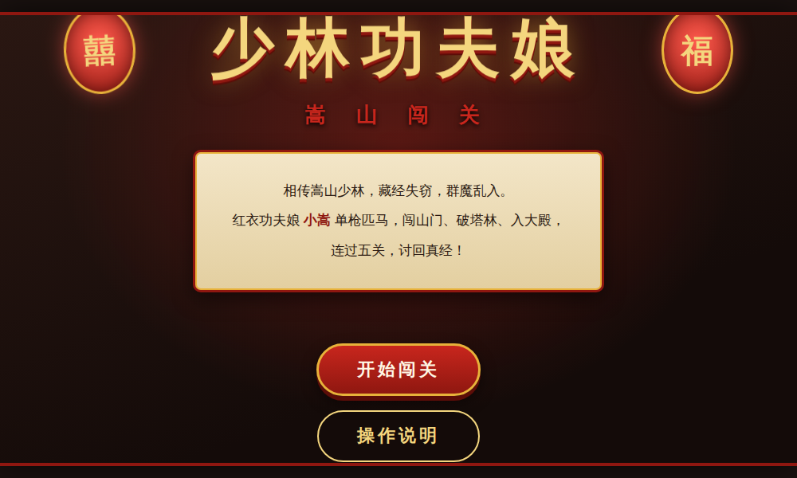
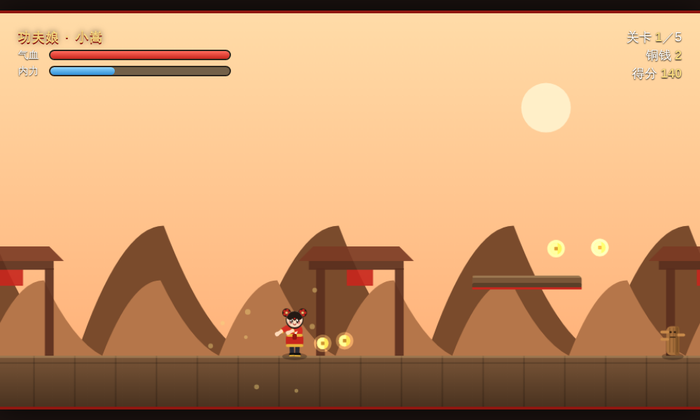
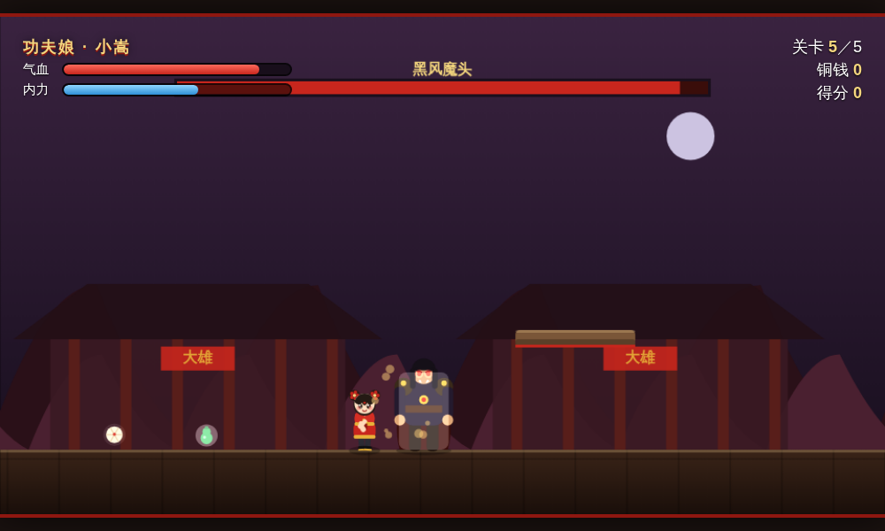
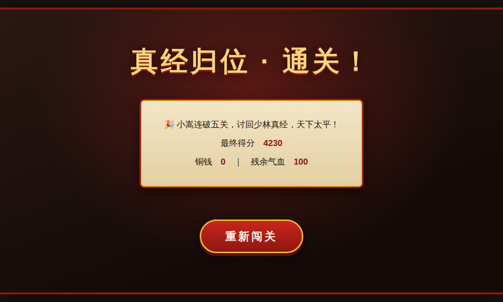

# 少林功夫娘 · 嵩山闯关 🥋

一款以 **中华娘造型的功夫小女孩「小嵩」** 为主角的横版动作闯关游戏。相传嵩山少林藏经失窃、群魔乱入，红衣功夫娘单枪匹马闯山门、破塔林、入大殿，连过五关，讨回真经！

纯 **HTML5 + Canvas + 原生 JavaScript** 实现，所有美术（角色、敌人、Boss、场景）均由代码实时绘制，**无任何外部素材、无需联网、无需构建**，双击即玩。



## 🎮 立即游玩

直接用浏览器打开 `index.html` 即可（Chrome / Edge / Firefox / Safari 均可）。

```bash
# 或本地起一个静态服务器
python3 -m http.server 8000
# 然后访问 http://localhost:8000
```

> 无需 `npm install`，无需打包工具。

## 🕹️ 操作说明

| 操作 | 键盘 |
| --- | --- |
| 移动 | `←` `→` / `A` `D` |
| 跳跃（可二段跳） | `↑` / `W` / `空格` |
| 出拳（快、近） | `J` |
| 飞踢（伤害高、可挑飞） | `K` |
| 气功波（远程，消耗内力） | `L` |
| 暂停 | `P` |

📱 **手机 / 平板**：屏幕下方自动出现虚拟按键（移动 + 跳 / 拳 / 踢 / 波）。

## ✨ 玩法特色

- **五大关卡**，各具嵩山少林主题场景：
  1. 少林山门 · 2. 练武场 · 3. 塔林 · 4. 藏经阁 · 5. 大雄宝殿（Boss 战）
- **一路向右清怪过关**：击败挡路妖人后「关门」开启，抵达即通关；第五关击败 **黑风魔头** 讨回真经通关。
- **三套招式**：拳、踢、气功波，配合二段跳的立体连招。
- **多种敌人**：木人桩、蒙面盗贼、大力士，以及会跳劈、放魔焰的 Boss。
- **道具系统**：🥟 包子回血、🍶 葫芦补内力、铜钱得分、真经大额加分。
- **连击加分**：连续击杀累积连击倍率，越猛得分越高。
- **打击感**：受击闪白、屏幕震动、粒子火花、WebAudio 音效。

| 关卡战斗 | Boss 战 | 通关 |
| --- | --- | --- |
|  |  |  |

## 🎨 角色设定

主角「小嵩」为 **中华娘** 造型：双丸子头配红头绳、眉心朱砂痣、红金对襟袄配盘扣腰带、宽袖布鞋，一招一式尽显功夫娘的英气与可爱。

## 🗂️ 项目结构

```
qihang/
├── index.html          # 页面结构、UI 覆盖层、虚拟按键
├── css/
│   └── style.css       # 中国风视觉样式（灯笼 / 卷轴 / 匾额）
├── js/
│   ├── sprites.js      # 纯 Canvas 绘制：角色、敌人、Boss、道具、场景
│   └── game.js         # 物理、战斗、AI、关卡、输入、音效、主循环
└── screenshots/        # 预览截图
```

## 🛠️ 技术要点

- 固定步长（60fps）游戏主循环，物理与渲染分离，掉帧不影响手感。
- AABB 碰撞、平台单向着陆、二段跳、攻击命中窗口与无敌帧。
- 简单有限状态机 Boss AI（贴身 / 跳劈冲击波 / 三向魔焰）。
- `requestAnimationFrame` 驱动，`WebAudio` 合成音效，零依赖。

—— 祝你早日通关，讨回真经！🏯
